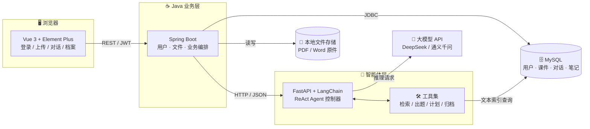

# 🎓 CourseMate

### 校园课程学习助手平台 · 基于 ReAct AI Agent

**让 AI 只讲你课件里的知识 —— 一个不会"编造知识点"的备考助手**

软件工程课程设计 · 4 人小组协作项目 · 前后端分离 + Java/Python 双服务架构

---

## 📖 目录

- [项目简介](#-项目简介)
- [适合谁用](#-适合谁用)
- [核心原理：ReAct 循环](#-核心原理react-循环)
- [系统架构](#️-系统架构)
- [功能模块](#-功能模块)
- [技术栈](#-技术栈)
- [团队分工](#-团队分工)

---

## 💡 项目简介

学生会用大模型复习，但通常只能拿到一份"看起来正确"的答案。真正的问题是：**AI 讲的和老师课件里写的不是一回事。**

本项目把 **ReAct（Reasoning + Acting）智能体**引入课程复习场景：学生上传自己的 PDF/Word 课件，AI 必须**先检索课件原文、再回答问题**，并在"思考 → 调用工具 → 观察结果"的循环里自主完成"检索知识点 → 生成复习提纲 → 出配套练习题 → 归档笔记"这一整套多步骤任务。

### 我们要解决的三个痛点

| 😖 传统大模型复习的痛点 | 💊 本项目的解法 |
| :--- | :--- |
| **知识幻觉**：靠预训练记忆作答，编造出课堂没讲过的结论 | 强制 Agent 优先检索用户上传的课件，答案以课件原文为依据，并标注来源 |
| **不会拆任务**：一句"下周考高数"只能得到一段泛泛而谈的话 | ReAct 循环自动拆解为多步子任务，按需调用 4 个工具逐步推进 |
| **记不住"你"**：读不了你的讲义，也不知道你的错题 | 解析 PDF/Word 建立文本索引，笔记、错题、对话记录全部落库，形成个人学习档案 |

### 项目目标

1. 搭建可解释的 ReAct 智能体，能拆解多步学习任务并自主调用工具。
2. 支持 PDF / Word 课件上传，提取文本并检索课件内的知识点。
3. 提供智能对话：生成复习提纲、配套习题、个性化备考计划。
4. 建立个人学习档案：笔记、错题、历史对话可随时回看。
5. 提供完整的网页界面：登录、课件管理、AI 对话、学习档案。

---

## 🎯 适合谁用

| 你的处境 | CourseMate 能帮你做什么 |
| :--- | :--- |
| 📅 **考试周冲刺** | 上传整门课的课件，一句话生成复习提纲 + 配套习题 + 倒排备考计划 |
| 😵 **某章听不懂** | 针对那一章提问，答案严格来自你自己的讲义，不是网上的通用解释 |
| 📝 **错题越堆越多** | 错题与解析自动归档，按课件、时间随时回看，考前集中刷一遍 |
| 🗂️ **笔记散落各处** | AI 生成的学习资料自动存进个人档案，不用再手抄、不用再翻聊天记录 |
| 🤔 **不信任 AI 的答案** | 每条结论都能追溯到你上传的课件原文，能查证才敢背 |

> 🎯 面向在校大学生，覆盖理工文史各类课程；只要能拿到 **PDF / Word 课件** 的课，就能用。

---

## 🔁 核心原理：ReAct 循环

ReAct = **Reason（推理思考）+ Act（行动）**。智能体不再"一口气生成答案"，而是像人一样边想边做：

**为什么这样能降低幻觉？**
因为每一轮 `Observation` 都是**真实查出来的课件原文**，模型的下一轮思考是建立在这段原文之上的，而不是凭记忆续写。

### 一次真实对话的完整轨迹

> 场景：登录后上传《高等数学.pdf》，对话框输入 **"下周要考高数极限，帮我复习"**

| 轮次 | 🧠 Thought（思考） | 🛠️ Action（行动） | 👀 Observation（观察） |
| :---: | :--- | :--- | :--- |
| 1 | 用户要复习极限，得先拿到课件里关于极限的内容 | 调用 `课件检索工具("极限")` | 返回课件原文：极限定义、两个重要极限、洛必达法则、等价无穷小替换、课堂例题 |
| 2 | 知识点已获取，基于这些内容生成提纲和练习题 | 调用 `习题生成工具(上下文, 3 题)` | 返回复习提纲 + 3 道极限计算题及详细解题步骤 |
| 3 | 任务基本完成，把本次资料存进学习档案 | 调用 `笔记归档工具(标题, 内容)` | 归档成功，返回笔记 ID |
| — | 结束循环 | — | 前端把 Markdown 渲染成带公式的富文本，用户在学习档案页可回看 |

> 🔒 **安全阀**：循环设有最大轮次上限（默认 8 轮）与任务完成判定，避免工具被无限调用造成死循环与 Token 浪费。

---

## 🏗️ 系统架构

前后端分离，业务服务与智能体服务分工明确：

| 层 | 职责 |
| :--- | :--- |
| **Vue 前端** | 页面渲染、表单校验、Markdown 与公式渲染 |
| **Spring Boot 业务层** | 用户鉴权、课件文件存储、数据库读写、请求编排 |
| **Python 智能体层** | ReAct 循环、4 个工具的实现、课件解析、调用大模型 |

---

## 🧩 功能模块

| # | 模块 | 关键功能 |
| :-: | :--- | :--- |
| 1 | **用户管理** | 注册、登录、密码加密，课件与笔记**仅本人可见** |
| 2 | **课件资源管理** | 上传 PDF/Word、自动提取文字、建立检索索引、课件列表与删除 |
| 3 | **AI Agent 对话**（核心） | ReAct 循环、「检索 / 出题 / 计划 / 归档」4 个工具、Markdown + 公式输出 |
| 4 | **个人学习档案** | 历史对话、AI 生成笔记、错题本，按课件与时间检索 |
| 5 | **Web 交互界面** | 登录页、课件页、对话页、档案页 |

> 📌 **能力边界**：仅解析文档中的**文字内容**，暂不支持图片、扫描件中的公式识别；图片识别（OCR）列入后续扩展计划。

---

## 🛠️ 技术栈

| 分类 | 技术 | 说明 |
| :--- | :--- | :--- |
| 前端 | Vue 3 + Vite + Element Plus | 页面开发与组件库 |
| 前端渲染 | markdown-it + KaTeX | 富文本与数学公式渲染 |
| 业务服务 | Spring Boot 3（JDK 17） | 用户鉴权、文件管理、业务编排 |
| 智能体 | Python + FastAPI + LangChain | ReAct Agent 编排与 HTTP 接口 |
| 文档解析 | PyPDF / python-docx | 课件文本提取 |
| 数据库 | MySQL 8.0 | 用户、课件索引、对话、笔记 |
| 大模型 | DeepSeek / 通义千问 | 通过 API 调用完成推理 |

---

## 👥 团队分工

| 成员 | 角色 | 主要职责 |
| :---: | :--- | :--- |
| **朱斌** | 🖥️ 前端开发 | Vue 页面、接口对接、Markdown 与公式渲染 |
| **黄博成** | ☕ 后端开发 | 数据库设计、用户与文件接口、服务编排 |
| **伍宇钊** | 🐍 Agent 开发 | LangChain ReAct 智能体、4 个工具、课件解析 |
| **严博誉** | 📋 测试 & 文档 | 功能测试、全套项目文档、用例图与流程图、答辩 PPT |

---

### ⭐ 如果这个项目对你有帮助，欢迎点个 Star

本项目为软件工程课程设计作品，仅供学习交流使用。

Made with ☕ + 🐍 + 💚 by 4 位同学

