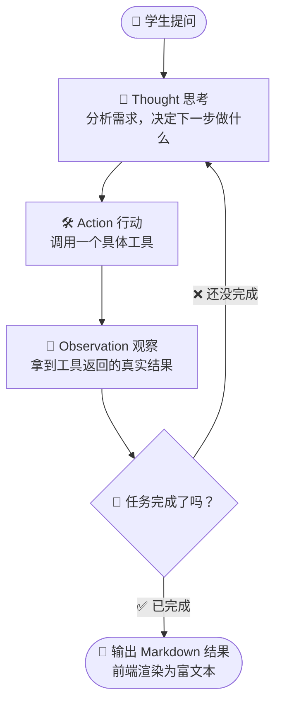
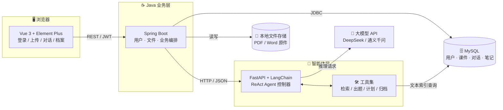
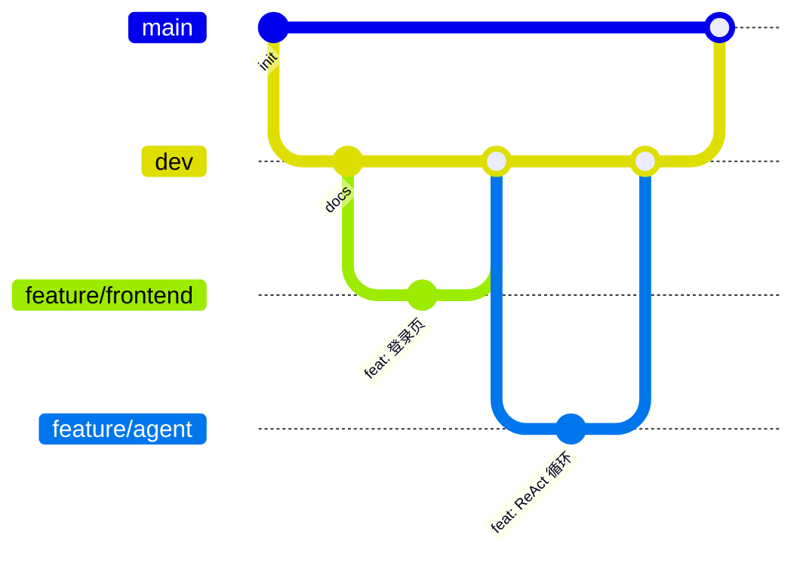

<div align="center">

# 🎓 CourseMate

### 校园课程学习助手平台 · 基于 ReAct AI Agent

**让 AI 只讲你课件里的知识 —— 一个不会"编造知识点"的备考助手**

[](#-当前进度)
[](#-技术栈)
[](#-技术栈)
[](#-技术栈)
[](#-技术栈)
[](#-技术栈)
[](#-如何参与)

<sub>软件工程课程设计 · 4 人小组协作项目 · 前后端分离 + Java/Python 双服务架构</sub>

</div>

---

> [!IMPORTANT]
> **当前阶段：第 0 周 · 前置准备**
> 仓库结构、协作规范、分支模型已就绪，**业务代码尚未开始编写**。
> 各位成员请先阅读 [团队协作规范](docs/01-团队协作规范.md)，按 [第 0 天检查清单](docs/01-团队协作规范.md#0-第-0-天检查清单先做完这些再动手) 把环境配好。

---

## 📖 目录

- [项目简介](#-项目简介)
- [核心原理：ReAct 循环](#-核心原理react-循环)
- [系统架构](#️-系统架构)
- [功能模块](#-功能模块)
- [技术栈](#-技术栈)
- [目录结构](#-目录结构)
- [快速开始](#-快速开始)
- [分支与协作模型](#-分支与协作模型)
- [团队分工](#-团队分工)
- [开发路线图](#-开发路线图)
- [文档索引](#-文档索引)
- [如何参与](#-如何参与)
- [常见问题](#-常见问题)

---

## 💡 项目简介

学生会用大模型复习，但通常只能拿到一份"看起来正确"的答案。真正的问题是：**AI 讲的和老师课件里写的不是一回事。**

本项目把 **ReAct（Reasoning + Acting）智能体**引入课程复习场景：学生上传自己的 PDF/Word 课件，AI 必须**先检索课件原文、再回答问题**，并在"思考 → 调用工具 → 观察结果"的循环里自主完成"检索知识点 → 生成复习提纲 → 出配套练习题 → 归档笔记"这一整套多步骤任务。

### 我们要解决的三个痛点

| 😖 传统大模型复习的痛点 | 💊 本项目的解法 |
| :--- | :--- |
| **知识幻觉**：靠预训练记忆作答，编造出课堂没讲过的结论 | 强制 Agent 优先检索用户上传的课件，答案以课件原文为依据，并标注来源 |
| **不会拆任务**：一句"下周考高数"只能得到一段泛泛而谈的话 | ReAct 循环自动拆解为多步子任务，按需调用 4 个工具逐步推进 |
| **记不住"你"**：读不了你的讲义，也不知道你的错题 | 解析 PDF/Word 建立文本索引，笔记、错题、对话记录全部落库，形成个人学习档案 |

### 项目目标

1. 搭建可解释的 ReAct 智能体，支持多步任务拆解与工具调用。
2. 支持 PDF / Word 课件上传、文本提取与课件内知识点检索。
3. 提供智能对话：生成复习提纲、配套习题、个性化备考计划。
4. 建立个人学习档案：笔记、错题、历史对话可随时回看。
5. 完成 Vue3 Web 界面：登录、课件管理、AI 对话、学习档案。
6. 走完软件工程完整流程：需求 → 设计 → 编码 → 测试 → 文档。

---

## 🔁 核心原理：ReAct 循环

ReAct = **Reason（推理思考）+ Act（行动）**。智能体不再"一口气生成答案"，而是像人一样边想边做：



**为什么这样能降低幻觉？**
因为每一轮 `Observation` 都是**真实查出来的课件原文**，模型的下一轮思考是建立在这段原文之上的，而不是凭记忆续写。

### 一次真实对话的完整轨迹

> 场景：登录后上传《高等数学.pdf》，对话框输入 **"下周要考高数极限，帮我复习"**

| 轮次 | 🧠 Thought（思考） | 🛠️ Action（行动） | 👀 Observation（观察） |
| :---: | :--- | :--- | :--- |
| 1 | 用户要复习极限，得先拿到课件里关于极限的内容 | 调用 `课件检索工具("极限")` | 返回课件原文：极限定义、两个重要极限、洛必达法则、等价无穷小替换、课堂例题 |
| 2 | 知识点已获取，基于这些内容生成提纲和练习题 | 调用 `习题生成工具(上下文, 3 题)` | 返回复习提纲 + 3 道极限计算题及详细解题步骤 |
| 3 | 任务基本完成，把本次资料存进学习档案 | 调用 `笔记归档工具(标题, 内容)` | 归档成功，返回笔记 ID |
| — | 结束循环 | — | 前端把 Markdown 渲染成带公式的富文本，用户在学习档案页可回看 |

> 🔒 **安全阀**：循环设有最大轮次上限（默认 8 轮）与任务完成判定，避免工具被无限调用造成死循环与 Token 浪费。

---

## 🏗️ 系统架构

前后端分离，业务服务与智能体服务之间通过 HTTP 通信，两侧职责清晰：



**分层职责**

| 层 | 职责 | 不该做的事 |
| :--- | :--- | :--- |
| **Vue 前端** | 页面渲染、表单校验、Markdown/公式渲染、调用 Java 接口 | 不直连 Python 服务，不存业务密钥 |
| **Spring Boot 业务层** | 用户鉴权、文件存储、数据库读写、请求编排与转发 | 不写 Agent 推理逻辑 |
| **Python 智能体层** | ReAct 循环、工具实现、PDF 解析、Prompt 管理、调用大模型 | 不直接操作业务数据库表结构（只读课件索引） |

---

## 🧩 功能模块

| # | 模块 | 关键功能 | 负责人 | 状态 |
| :-: | :--- | :--- | :-: | :-: |
| 1 | **用户管理** | 注册、登录、密码加密、JWT 鉴权、数据隔离（课件笔记仅本人可见） | Spring 后端 | 🟡 设计完成 |
| 2 | **课件资源管理** | 上传 PDF/Word、文本提取与清洗、建立文本索引、课件列表与删除 | Spring 后端 + Agent | 🟡 设计完成 |
| 3 | **AI Agent 对话**（核心） | ReAct 循环、「检索/出题/计划/归档」4 个工具、Markdown + 公式输出 | Python Agent | 🟡 设计完成 |
| 4 | **个人学习档案** | 历史对话、AI 生成笔记、错题本、按课件/时间检索 | 前端 + 后端 | 🟡 设计完成 |
| 5 | **Web 交互界面** | 登录页、课件页、对话页、档案页、响应式布局 | 前端 | 🟡 设计完成 |

> 📌 **边界说明（基础版本）**：仅解析文档中的**文字内容**，暂不支持图片/扫描件中的公式识别；OCR 列入后续扩展。

---

## 🛠️ 技术栈

| 分类 | 技术 | 版本约定 | 说明 |
| :--- | :--- | :--- | :--- |
| 前端 | Vue 3 + Vite | Node 20+ | 组合式 API，页面开发 |
| 前端 UI | Element Plus | — | 表单、表格、对话框 |
| 前端渲染 | markdown-it + KaTeX | — | 富文本与数学公式渲染 |
| 业务服务 | Spring Boot | JDK 17 | REST 接口、鉴权、文件管理 |
| 业务服务 | MyBatis-Plus / JPA | — | 数据库访问 |
| 智能体 | Python + FastAPI | Python 3.11+ | 提供 Agent HTTP 接口 |
| 智能体 | LangChain | — | ReAct Agent 编排 |
| 智能体 | PyPDF / python-docx | — | 课件文本提取 |
| 数据库 | MySQL | 8.0 | 用户、课件索引、对话、笔记 |
| 大模型 | DeepSeek / 通义千问 | — | 通过 API 调用，密钥走环境变量 |
| 协作 | Git + GitHub | — | 分支管理、Pull Request 评审 |

> ⚠️ **密钥安全**：大模型 API Key、数据库密码一律放在本地 `.env` 或 `application-local.yml`，**已在 `.gitignore` 中屏蔽，严禁提交**。

---

## 📁 目录结构

```text
-ReAct-AI-Agent-/
├── README.md                      # 本文件
├── .gitignore                     # 忽略规则（密钥/依赖/构建产物）
├── .gitattributes                 # 换行符与二进制文件规范
├── .editorconfig                  # 编辑器统一格式
├── docs/                          # 📚 全套项目文档
│   ├── 00-项目介绍.md              # 需求原文（项目概述与背景）
│   ├── 01-团队协作规范.md          # ⭐ 零基础组员必读
│   ├── 02-Git命令速查表.md         # 常用命令一页纸
│   └── 03-开发环境与接口约定.md     # 版本、端口、命名、接口前缀
├── .github/
│   ├── PULL_REQUEST_TEMPLATE.md   # PR 模板（自动带出）
│   └── ISSUE_TEMPLATE/            # Issue 模板
├── frontend/                      # 🖥️ Vue3 前端（成员 1）
├── backend/                       # ☕ Spring Boot 业务服务（成员 2）
└── agent/                         # 🐍 Python ReAct 智能体（成员 3）
```

---

## 🚀 快速开始

> ⏳ **代码尚未提交**，以下为规划中的启动方式，第 2 周起逐步可用。

### 1. 拿到代码

```bash
git clone https://github.com/wuyuzhao102/-ReAct-AI-Agent-.git
cd -ReAct-AI-Agent-
git switch dev          # ⚠️ 从 dev 分支开始工作，不要直接在 main 上改
```

### 2. 启动各服务（规划）

```bash
# 前端 —— http://localhost:5173
cd frontend && npm install && npm run dev

# 业务服务 —— http://localhost:8080
cd backend && ./mvnw spring-boot:run

# 智能体服务 —— http://localhost:8000
cd agent && pip install -r requirements.txt && uvicorn app.main:app --reload --port 8000
```

### 3. 数据库（规划）

```sql
CREATE DATABASE coursemate DEFAULT CHARACTER SET utf8mb4 COLLATE utf8mb4_unicode_ci;
```

> 详细环境搭建与版本要求见 [开发环境与接口约定](docs/03-开发环境与接口约定.md)。

---

## 🌿 分支与协作模型

采用 **GitHub Flow 简化版**，四条长期分支 + 按功能拆分的短期分支：



| 分支 | 用途 | 谁能直接推 | 保护策略 |
| :--- | :--- | :--- | :--- |
| `main` | 交付主干，永远可运行 | ❌ 任何人都不行 | 仅接受 PR 合并，需 1 人 Review |
| `dev` | 集成分支，四人代码在此汇合 | ❌ 通过 PR | 仅接受 PR 合并 |
| `feature/frontend` | 成员 1 的日常开发分支 | ✅ 成员 1 | — |
| `feature/backend` | 成员 2 的日常开发分支 | ✅ 成员 2 | — |
| `feature/agent` | 成员 3 的日常开发分支 | ✅ 成员 3 | — |
| `feature/docs` | 成员 4 的文档/测试分支 | ✅ 成员 4 | — |
| `hotfix/*` | 紧急修复 | 由负责人开 | 修完立刻合回 `dev` 与 `main` |

**提交信息格式**：`类型(模块): 简短说明`，例如 `feat(frontend): 完成登录页表单校验`

<details>
<summary><b>👉 点开查看完整工作流（每个成员每天都要用）</b></summary>

```bash
# ① 早上先同步最新代码
git switch dev
git pull
git switch feature/frontend
git merge dev

# ② 开发……

# ③ 提交前先看看自己改了什么
git status
git diff

# ④ 提交并推送
git add .
git commit -m "feat(frontend): 完成登录页表单校验"
git push

# ⑤ 功能做完了 → 到 GitHub 网页发 Pull Request 合并到 dev
```

</details>

> 📘 零基础同学请**逐字照做** [团队协作规范](docs/01-团队协作规范.md)，里面有每一步的完整操作与报错处理。

---

## 👥 团队分工

| 成员 | 角色 | 主要职责 | 工作分支 | 交付物 |
| :---: | :--- | :--- | :--- | :--- |
| **朱斌** | 🖥️ 前端开发 | Vue 页面、接口对接、Markdown/公式渲染 | `feature/frontend` | 登录 / 课件 / 对话 / 档案 页面 |
| **黄博成** | ☕ 后端开发 | 数据库设计、用户与文件接口、调用 Python 服务 | `feature/backend` | 表结构、REST 接口、服务编排 |
| **伍宇钊** | 🐍 Agent 开发 | LangChain ReAct 智能体、4 个工具、PDF 解析与清洗 | `feature/agent` | Agent 服务、工具实现、Prompt |
| **严博誉** | 📋 测试 & 文档 | 仓库管理、功能测试、全套文档、用例图与流程图、答辩 PPT | `feature/docs` | 需求/设计/测试文档、PPT |

> 🙋 **GitHub 用户名待补充**：请各位把自己的 GitHub 用户名 / 昵称填到上面表格（或告知仓库负责人统一添加为 Collaborator）。

---

## 📅 开发路线图

- [x] **第 0 周 · 前置准备**：Git/GitHub 环境、仓库初始化、分支模型、协作规范、README
- [ ] **第 1 周 · 需求与设计**：需求规格说明书、用例图、ER 图、接口文档、原型图
- [ ] **第 2 周 · 骨架搭建**：前端脚手架、Spring Boot 骨架、FastAPI 骨架、数据库建表
- [ ] **第 3 周 · 核心功能**：用户模块 + 课件上传解析 + 文本索引
- [ ] **第 4 周 · 核心亮点**：ReAct Agent 循环 + 4 个工具 + 对话页面
- [ ] **第 5 周 · 完善**：学习档案、笔记错题、Markdown 渲染、界面美化
- [ ] **第 6 周 · 测试与交付**：功能测试、Bug 修复、文档定稿、答辩 PPT、演示视频

---

## 📚 文档索引

| 文档 | 内容 | 适合谁 |
| :--- | :--- | :--- |
| [00-项目介绍](docs/00-项目介绍.md) | 项目概述、背景、目标、难点与扩展方向 | 所有人 / 答辩 |
| [01-团队协作规范](docs/01-团队协作规范.md) | ⭐ Git 环境配置、克隆、提交流程、PR、冲突、禁忌、FAQ | **零基础成员必读** |
| [02-Git 命令速查表](docs/02-Git命令速查表.md) | 一页纸命令，可打印贴在桌边 | 所有人 |
| [03-开发环境与接口约定](docs/03-开发环境与接口约定.md) | 版本、端口、命名、接口前缀、密钥管理 | 开发成员 |
| [PR 模板](.github/PULL_REQUEST_TEMPLATE.md) | 提交 PR 时自动带出检查清单 | 所有人 |

---

## 🤝 如何参与

1. **加仓库**：把你的 GitHub 用户名发给仓库管理员，被添加为 Collaborator 后即可获得写权限。
2. **读规范**：花 15 分钟读完 [团队协作规范](docs/01-团队协作规范.md)，把环境配好。
3. **领任务**：在 [Issues](../../issues) 里认领一个未分配的任务，评论"我来做"，然后切到自己的 feature 分支开工。

**报告问题**：请使用 [Issue 模板](../../issues/new/choose)，附上报错原文与截图，不要只发一句"跑不起来"。

---

## ❓ 常见问题

<details>
<summary><b><code>git push</code> 提示 <code>Authentication failed</code> 怎么办？</b></summary>

GitHub 已不支持账号密码推送，需要用 **Personal Access Token** 代替密码。生成方式见 [团队协作规范 · 配置登录凭据](docs/01-团队协作规范.md)。
</details>

<details>
<summary><b>提示 <code>Updates were rejected because the remote contains work...</code></b></summary>

说明远端有你本地没有的提交。先 `git pull` 拉下来再 `git push` 即可，**不要用 `git push -f`**。
</details>

<details>
<summary><b>我不小心把 <code>node_modules</code> / 密码文件提交了？</b></summary>

不要慌，立即执行：

```bash
git rm -r --cached 出错的文件或目录
git commit -m "chore: 移除误提交的文件"
git push
```

如果是 API Key 已经推到远端，**立刻到服务商后台作废并重新生成**，然后再清理历史。
</details>

<details>
<summary><b>为什么我 <code>git status</code> 看到一堆 <code>\346\226\207\346\241\243</code> 这样的乱码？</b></summary>

中文文件名被转义了，执行一次即可修复：

```bash
git config --global core.quotepath false
```
</details>

---

<div align="center">

### ⭐ 如果这个项目对你有帮助，欢迎点个 Star

<sub>本项目为软件工程课程设计作品，仅供学习交流使用。</sub>

<sub>Made with ☕ + 🐍 + 💚 by 4 位同学</sub>

</div>
