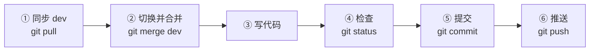

# 📘 团队协作规范（Git + GitHub）

> **读者对象**：本项目 4 人小组全体成员，**假设你从没用过 Git**。
> **使用方式**：第一次动手时从头到尾照着做一遍；之后只需要反复用 [第 6 章「每天的标准六步」](#6-每天的标准六步背下来)。
> **遇到报错**：先查 [第 13 章 报错速查表](#13-报错速查表)，查不到再把**完整报错原文 + 截图**发到群里。

---

## 目录

- [0. 第 0 天检查清单（先做完这些再动手）](#0-第-0-天检查清单先做完这些再动手)
- [1. 先搞懂三个词](#1-先搞懂三个词)
- [2. 配置 Git（一台电脑只做一次）](#2-配置-git一台电脑只做一次)
- [3. 加入仓库](#3-加入仓库)
- [4. 第一次把仓库拉到电脑上](#4-第一次把仓库拉到电脑上)
- [5. 分支：每个人一条自己的道](#5-分支每个人一条自己的道)
- [6. 每天的标准六步（背下来）](#6-每天的标准六步背下来)
- [7. 提交信息规范](#7-提交信息规范)
- [8. 发 Pull Request](#8-发-pull-request)
- [9. 代码评审 Review](#9-代码评审-review)
- [10. 冲突了怎么办](#10-冲突了怎么办)
- [11. 禁忌清单 ⛔](#11-禁忌清单-)
- [12. 后悔药：改错了怎么撤回](#12-后悔药改错了怎么撤回)
- [13. 报错速查表](#13-报错速查表)
- [14. 沟通与节奏](#14-沟通与节奏)
- [15. 附录：一次性配置汇总](#15-附录一次性配置汇总)

---

## 0. 第 0 天检查清单（先做完这些再动手）

把下面每一项打勾，**全部 ✅ 之后**再开始写自己的功能。

| # | 要做的事 | 怎么算完成 | ✅ |
| :-: | :--- | :--- | :-: |
| 1 | 注册 GitHub 账号 | 能登录 github.com，记得自己的**用户名** | ☐ |
| 2 | 安装 Git | 命令行输入 `git --version` 能显示版本号 | ☐ |
| 3 | 把 GitHub 用户名发给**仓库管理员** | 管理员回你"已加入" | ☐ |
| 4 | 配置 Git 身份（姓名+邮箱） | `git config --global user.name` 有输出 | ☐ |
| 5 | 生成访问令牌 PAT 并存好 | 手里有一串 `ghp_` 开头的字符串 | ☐ |
| 6 | 克隆仓库成功 | 本地能看到 `README.md` 和 `docs` 文件夹 | ☐ |
| 7 | 切到自己的分支 | `git branch` 前面有 `*` 的是自己的分支 | ☐ |
| 8 | 成功推送一次空改动 | GitHub 网页上能看到你刚提交的记录 | ☐ |
| 9 | 读完本文第 6 / 7 / 11 章 | —— | ☐ |

> ⚠️ **第 8 项非常重要**：先随便改一行文档、推一次。**在真正写功能之前，先确认你的"推送通道"是通的**，否则等到 deadline 前一天才发现推不上去，会很痛苦。

---

## 1. 先搞懂三个词

不用背定义，用"打游戏存档"理解就够了：

| 词 | 通俗理解 | 对应的命令 |
| :--- | :--- | :--- |
| **仓库 Repository** | 一个能被"存档"的项目文件夹 | `git clone` |
| **提交 Commit** | 一次存档，附带一句说明 | `git commit` |
| **分支 Branch** | 一条独立的剧情线，互不干扰 | `git switch` |
| **推送 Push** | 把本地存档上传到云端（GitHub） | `git push` |
| **拉取 Pull** | 把云端别人的存档下载到本地 | `git pull` |

**我们的玩法（一句话版）**：

> 四个人各自在自己的分支上存档，随时推到云端；功能做完后，在 GitHub 网页上申请"把我的分支合并到 `dev`"，由文档负责人点合并。**谁都不许直接改 `main`。**

---

## 2. 配置 Git（一台电脑只做一次）

### 2.1 确认 Git 装好了

打开命令行（Windows：按 `Win` 键搜 **Git Bash**，或在项目文件夹空白处右键 → **Open Git Bash here**），输入：

```bash
git --version
```

看到类似 `git version 2.50.1.windows.1` 就说明装好了。

### 2.2 配置你的身份（必须）

```bash
git config --global user.name "你的名字"
git config --global user.email "你注册GitHub用的邮箱"
```

> 这两行决定了提交记录上显示的是谁。**写错了要立刻改**，否则别人不知道这个提交是谁做的。

> [!IMPORTANT]
> **`user.email` 必须是「已经绑定在你这个 GitHub 账号上」的邮箱。**
>
> 检查方法：GitHub → 右上角头像 → **Settings** → **Emails**，确认这个邮箱出现在列表里。
>
> **为什么必须一致**：GitHub 是拿 **commit 里的作者邮箱** 去匹配账号的 ——
>
> | 邮箱情况 | 后果 |
> | :--- | :--- |
> | 匹配到你的账号 | 提交记在你名下，头像正常，贡献统计正确 |
> | 匹配到**你的另一个账号** | 提交算给那个账号，Contributors 里出现"第二个人" |
> | 谁都不匹配 | 记成一个**没有头像的幽灵作者**，你的工作量不计入 |
>
> 最常见的翻车场景：电脑上全局配着很久以前的邮箱（比如旧 QQ 邮箱），而 GitHub 账号绑的是另一个邮箱。于是全组的提交都被算到一个"不存在的第五人"头上，答辩截图里 Contributors 数量对不上。
>
> 改完记得同步：`git config --global user.email "新邮箱"` —— **只影响之后的提交**，旧提交不会自动改。

顺手把下面几项也配好（**强烈建议全部执行一次**）：

```bash
git config --global core.quotepath false      # 中文文件名不再显示成 \346\226\207 乱码
git config --global core.autocrlf false       # 换行符交给 .gitattributes 统一管理
git config --global init.defaultBranch main   # 新仓库默认分支叫 main
git config --global pull.rebase false         # 拉取时用 merge，新手不容易搞乱
git config --global http.postBuffer 524288000 # 网络差时推大文件不容易断
```

检查一下：

```bash
git config --global --list
```

### 2.3 配置登录凭据（最容易卡住的一步 ⚠️）

GitHub **早就不支持用账号密码推送**了。现在必须用 **Personal Access Token（简称 PAT）** 当密码。

**生成步骤：**

1. 浏览器登录 GitHub → 右上角头像 → **Settings**
2. 拉到左栏最下面 → **Developer settings**
3. **Personal access tokens** → **Tokens (classic)**
4. 右上角 **Generate new token** → **Generate new token (classic)**
5. 填写：
   - **Note**：`class-project-git`
   - **Expiration**：`90 days`（够用一学期）
   - **Select scopes**：**只勾选 `repo`**（这一项就够推拉代码了，别多勾）
6. 拉到底 → **Generate token**
7. 复制那串 `ghp_xxxxxxxxxxxx` —— **它只显示这一次**，立刻存到你的备忘录/密码管理器里

**第一次推送时怎么用：**

```bash
git push
# Username for 'https://github.com':   ← 输入你的 GitHub 用户名（不是昵称！）
# Password for 'https://xxx@github.com': ← 粘贴刚才的 ghp_ 开头令牌（粘贴时屏幕不显示字符，是正常的）
```

推送成功后，Windows 会把它存进「凭据管理器」，以后就不用再输了。

**令牌过期/密码改了怎么办？**

打开：控制面板 → 用户账户 → 凭据管理器 → **Windows 凭据** → 找到 `git:https://github.com` → **删除**，然后重新 `git push`，重新输入用户名和新令牌。

> 💡 **不想碰命令行？** 见 [附录 B：图形化替代方案](#附录-b图形化替代方案github-desktop)。

---

## 3. 加入仓库

仓库地址：**https://github.com/wuyuzhao102/-ReAct-AI-Agent-**

1. 把你的 **GitHub 用户名**发给仓库管理员（成员 4）。
2. 管理员操作：仓库页 → **Settings** → 左侧 **Collaborators** → **Add people** → 搜索用户名 → 发送邀请。
3. 你会在 GitHub 收到一封邮件，或在 https://github.com/notifications 看到邀请，点 **Accept invitation**。
4. 接受后打开仓库页面，能看到 **Settings** 之外的写权限，说明就绪。

> ❗ 没被加入就直接 `git push` 会报 `403 Permission denied`。

---

## 4. 第一次把仓库拉到电脑上

> 全程只做一次。以后用 `git pull` 同步即可。

### 4.1 先在电脑上建一个专门放项目的文件夹

建议路径：`D:\Projects`（**不要放在桌面、不要用中文路径、不要在 OneDrive/网盘同步目录里**，会引发各种奇怪问题）。

### 4.2 克隆

在 `D:\Projects` 文件夹里右键 → **Open Git Bash here**，输入：

```bash
git clone https://github.com/wuyuzhao102/-ReAct-AI-Agent-.git
```

> 项目名前后各有一个短横线 `-`，是仓库原本的名字，**复制粘贴最稳，不要手打**。

完成后：

```bash
cd -- "-ReAct-AI-Agent-"
ls
```

能看到 `README.md`、`docs`、`frontend`、`backend`、`agent` 这些就是成功了。

### 4.3 切到 `dev` 分支

```bash
git switch dev
```

`dev` 是四个人的代码汇合的地方，**我们不在 `main` 上写东西**。

---

## 5. 分支：每个人一条自己的道

### 5.1 分支对照表

| 分支 | 谁的 | 能不能直接推 | 说明 |
| :--- | :--- | :---: | :--- |
| `main` | —— | ❌ **谁都不能** | 交付主干，永远可运行，只接受 PR 合并 |
| `dev` | 全体 | ❌ **不能** | 集成分支，大家的代码在这里汇合 |
| `feature/frontend` | 成员 1 前端 | ✅ 能 | 你每天的代码都推到这里 |
| `feature/backend` | 成员 2 后端 | ✅ 能 | 同上 |
| `feature/agent` | 成员 3 Agent | ✅ 能 | 同上 |
| `feature/docs` | 成员 4 文档测试 | ✅ 能 | 同上 |

### 5.2 切到自己的分支

```bash
git switch feature/frontend     # 换成你自己的分支名
```

> 如果提示 `invalid reference`，说明远端还没有这条分支，用下面这条创建并切换：
>
> ```bash
> git switch -c feature/frontend
> git push -u origin feature/frontend
> ```
>
> 创建成功后告诉其他人一声，避免重复创建。

### 5.3 确认自己在哪条分支上

**每次开始写代码前，先敲这一行：**

```bash
git branch
```

前面带 `*` 的就是你当前所在分支。**不是 `feature/你名字` 就先切过去**。

```bash
* feature/frontend
  dev
  main
```

---

## 6. 每天的标准六步（背下来）

> 这六步会重复到你项目结束。**照着顺序做，不要跳步。**



### ① 早上第一件事：把云端最新的 `dev` 拉下来

```bash
git switch dev
git pull
```

### ② 切回自己的分支，把 `dev` 的最新内容合并进来

```bash
git switch feature/frontend
git merge dev
```

> 这一步是**每天必做**。保持自己的分支跟得上 `dev`，可以避免最后合并时的"大地震"。

### ③ 写你的代码 / 文档

### ④ 看看自己到底改了哪些文件

```bash
git status
git diff
```

> 🚨 **`git status` 里出现的每一个文件，你都要能说出"这是我改的"。**
> 如果看到 `node_modules/`、`target/`、`.env`、`*.pdf` 之类，**先停下来**，说明 `.gitignore` 可能没生效，问一下管理员，不要直接 `git add .`。

### ⑤ 提交

```bash
git add .                                  # 暂存所有改动
git commit -m "feat(frontend): 完成登录页表单校验"
```

> 想只提交某几个文件：`git add src/views/Login.vue docs/xx.md`
> 提交说明的格式见 [第 7 章](#7-提交信息规范)。

### ⑥ 推送

```bash
git push
```

第一次推新分支需要带上对应关系：

```bash
git push -u origin feature/frontend
```

> 推完可以去 GitHub 网页上刷新，能看到自己的提交记录就成功了。

---

## 7. 提交信息规范

**格式（三部分，缺一不可）：**

```
类型(模块): 一句话说明你做了什么
```

**类型（type）只能从下面选：**

| 类型 | 什么时候用 | 例子 |
| :--- | :--- | :--- |
| `feat` | 新增功能 | `feat(agent): 实现课件检索工具` |
| `fix` | 修 Bug | `fix(backend): 修复上传空文件报 500` |
| `docs` | 只改文档 | `docs(readme): 补充环境搭建步骤` |
| `style` | 只改格式（不影响逻辑） | `style(frontend): 统一缩进为 2 空格` |
| `refactor` | 重构（不改功能） | `refactor(agent): 抽出 prompt 模板文件` |
| `test` | 加/改测试 | `test(backend): 补充登录接口用例` |
| `chore` | 杂务（配置、依赖） | `chore: 升级 element-plus 版本` |

**模块（scope）**：`frontend` / `backend` / `agent` / `docs` / `readme` / `config` 之类。

**✅ 好的提交信息：**

```
feat(frontend): 完成登录页表单校验与错误提示
fix(agent): 修复 PDF 解析后出现大量空行的问题
docs(collab): 补充 PAT 过期后的处理方法
```

**❌ 不好的提交信息：**

```
update                    ← 更新了什么？不知道
修改                      ← 同上
1                         ← 完全无法理解
asdfasdf                  ← 不要这样
改了好多东西                ← 一次提交塞了太多件事
```

**额外要求：**

- 一行写完，**不超过 50 个汉字**。
- **一次提交只做一件事**。改了三个不相关的功能就分三次提交。
- 不要用句号结尾，不要全大写英文。

---

## 8. 发 Pull Request

> **Pull Request（简称 PR）**：把你的分支"申请合并"到 `dev` 的请求。这是我们对代码唯一的合并方式。

**什么时候发？** 一个完整的功能做完、自测通过之后（比如"登录功能整条链路能跑通"），不是每提交一次就发。

**步骤：**

1. 确认代码已经 `git push` 到自己的分支。
2. 打开仓库页面 https://github.com/wuyuzhao102/-ReAct-AI-Agent-
3. 顶部会出现一条黄色提示条 → 点 **Compare & pull request**。
   （没看到的话：点 **Pull requests** → **New pull request** → `base: dev` ← `compare: feature/frontend`）
4. 填写 PR：
   - **标题**：和提交信息同样风格，例如 `feat(frontend): 登录页与表单校验`
   - **描述**：会**自动带出**仓库里的 PR 模板，按模板把每一项填掉
5. 右侧 **Reviewers** → 选一位同学（一般是成员 4 或对应模块负责人）
6. 点 **Create pull request**
7. 在群里 @ 一下 reviewer："PR #12 待评审"
8. reviewer 点了 **Approve** 后，由 reviewer 点 **Squash and merge** 合并到 `dev`
9. 合并后点 **Delete branch**（如果这条分支还要继续用，就跳过）

**PR 里要写清楚：**

- 我做了什么（对应哪个 Issue，如 `Closes #12`）
- 我自测了什么（截图 / 接口返回）
- 有什么已知问题、需要谁配合

> ❗ 不要发"巨型 PR"（一次改 40 个文件、800 行）。功能拆小一点，PR 小一点，评审才看得动。

---

## 9. 代码评审 Review

**作为 reviewer，你只需要检查四件事：**

1. 能不能跑起来（拉下分支自己跑一遍）
2. 有没有把 `.env`、密码、`node_modules` 之类提交上来
3. 命名和代码风格是否和项目一致
4. 有没有明显逻辑错误 / 死循环 / 硬编码的本地路径（如 `D:\我的电脑\xxx`）

**评审意见怎么说：**

- 必须改的：`【必须】这里要判空，否则会 500`
- 建议改的：`【建议】这个变量名改成 camelCase 更清楚`
- 只是提问：`【疑问】这里为什么不用现成的工具函数？`

**被评审的一方**：改完继续往自己的分支 `git push`，PR 会自动更新，不用重新发。

---

## 10. 冲突了怎么办

**冲突（Conflict）**：你和别人改了**同一个文件的同一行**，Git 不知道该听谁的。

**典型表现：**

```
Auto-merging docs/01-团队协作规范.md
CONFLICT (content): Merge conflict in docs/01-团队协作规范.md
Automatic merge failed; fix conflicts and then commit the result.
```

### 处理步骤（新手版，照做即可）

**第 1 步**：`git status` 看哪些文件冲突了（`both modified:` 后面那几行）。

**第 2 步**：用编辑器打开这些文件，会看到这样的标记：

```
<<<<<<< HEAD
我写的内容
=======
别人写的内容
>>>>>>> dev
```

**第 3 步**：手动改成你想要的结果 —— **保留两边有用的部分，删掉 `<<<<<<<`、`=======`、`>>>>>>>` 这三行标记**。

```text
最终应该是这样（没有任何箭头标记）：
我写的内容
别人补充的内容
```

**第 4 步**：保存文件，然后：

```bash
git add 冲突的文件名
git commit -m "merge: 解决 docs 分支冲突"
git push
```

### 🆘 不想自己解决？

**立刻停手，把冲突的文件名发到群里**，让改这个文件的人一起看。**绝对不要**为了省事这样干：

```bash
git checkout --theirs .   # ❌ 会直接把别人的改动全部丢掉
git reset --hard          # ❌ 会丢失你所有未提交的改动
```

### 预防冲突的三个习惯

1. **每天开工先 `git merge dev`**，不要攒一周再合并。
2. **一个文件尽量只有一个人负责**。`docs/01-团队协作规范.md` 这种公共文件，改之前先在群里说一声。
3. **改完就推**，不要本地压几十个提交。

---

## 11. 禁忌清单 ⛔

> 下面每一条都是真实会出事的行为。**违反会造成别人几个小时的代码消失。**

| # | ❌ 绝对不要做 | ✅ 应该这样做 |
| :-: | :--- | :--- |
| 1 | 直接 `git push` 到 `main` 或 `dev`；**或者在 GitHub 网页上直接编辑这两个分支里的文件**（一样属于直接改分支） | 推到自己的 `feature/*`，然后发 PR |
| 2 | 用 `git push -f` / `git push --force` 强推共享分支 | 只有管理员在明确通知后才能用 |
| 3 | 提交 `.env`、`application-local.yml`、API Key、数据库密码 | 放在本地文件里，`.gitignore` 已屏蔽 |
| 4 | 提交 `node_modules/`、`target/`、`venv/`、`dist/` | 这些都能自动生成，`.gitignore` 已屏蔽 |
| 5 | 把课件 PDF、视频、安装包传上仓库（>50MB 会被拒） | 放本地 `uploads/`，只提交代码和小文档 |
| 6 | `git add .` 之前不看 `git status` | 每次都先看，确认没有奇怪的文件 |
| 7 | `git reset --hard` / `git clean -fd` 清空别人的东西 | 自己的改动用 `git stash` 暂存 |
| 8 | 在别人的 `feature/*` 分支上提交代码 | 只在写着你自己名字的分支上干活 |
| 9 | 删除或重写别人写的文件、模块 | 需要改动先沟通，走 PR |
| 10 | 提交里出现"测试1""aaaa""111"这种信息 | 按第 7 章规范写 |
| 11 | 把个人信息（学号、身份证、手机号、住址）提交到公开仓库 | 该仓库是 **Public**，全世界可见 |
| 12 | 遇到问题就 `git reset --hard` 重来 | 先 `git status` + 问人，Git 几乎不会真的丢东西 |

---

## 12. 后悔药：改错了怎么撤回

> 全部是**安全**操作，不会影响别人的代码。

| 我干了什么 | 我想怎样 | 命令 |
| :--- | :--- | :--- |
| 改坏了文件，还没 add | 放弃这个文件的改动 | `git restore 文件名` |
| `git add` 错了文件 | 从暂存区拿出来（保留改动） | `git restore --staged 文件名` |
| 提交信息写错了，还没推 | 改最后一次提交的说明 | `git commit --amend -m "新的说明"` |
| 提交错了，还没推 | 撤销提交但保留代码 | `git reset --soft HEAD~1` |
| 提交里混进一个不该提交的文件 | 从 Git 移除但保留本地文件 | `git rm --cached 文件路径` |
| 想临时保存改动去切分支 | 暂存起来 | `git stash` → 回来后 `git stash pop` |
| 想看自己提交过什么 | 查看历史 | `git log --oneline -10` |
| **已经 push 到自己的分支了** | 想撤回 | 找管理员，**不要自己动手** |
| 实在搞乱了 | 重新克隆一份 | 见下方 |

**终极兜底（安全，你本地没推的东西会丢，推过的都在云端）：**

```bash
cd ..
rm -rf -- "-ReAct-AI-Agent-"
git clone https://github.com/wuyuzhao102/-ReAct-AI-Agent-.git
```

> 你的代码只要 `git push` 过就还在；本地没推过的改动会丢。所以 —— **改一点就推一点**。

---

## 13. 报错速查表

| 报错信息（关键词） | 原因 | 解决办法 |
| :--- | :--- | :--- |
| `fatal: not a git repository` | 你不在项目文件夹里 | `cd` 到项目目录；用 `pwd` / `ls` 确认 |
| `Authentication failed` / `Invalid username or password` | 用了账号密码，或 PAT 过期/没勾 `repo` | 重新生成 PAT；清除 Windows 凭据后重推 |
| `remote: Permission to ... denied` / `403` | 你还没被加为 Collaborator | 找管理员加你 |
| `Permission denied (publickey)` | 配置了 SSH 但没上传公钥 | 改用 HTTPS 地址：`git remote set-url origin https://github.com/...` |
| `Updates were rejected because the remote contains work...` | 远端有你没有的提交 | `git pull` 后再 `git push`（**不要 `-f`**） |
| `Your local changes would be overwritten by merge` | 你有未提交的改动，挡住合并 | `git stash` → 合并 → `git stash pop` |
| `CONFLICT (content)` | 冲突 | 见 [第 10 章](#10-冲突了怎么办) |
| `error: pathspec 'xxx' did not match` | 分支/文件名打错了 | `git branch -a` 看分支，`ls` 看文件名 |
| `filename too long` | Windows 路径长度限制 | `git config --global core.longpaths true` |
| 中文文件名显示成 `\346\226\207` | quotepath 没关 | `git config --global core.quotepath false` |
| `fatal: refusing to merge unrelated histories` | 本地和远端是两个毫无关系的仓库 | 找管理员，不要自己加 `--allow-unrelated-histories` |
| 推送卡住/超时 | 网络问题 | 重试；或 `git config --global http.postBuffer 524288000` |
| `LF will be replaced by CRLF` | 换行符提示，**不是错误** | 忽略即可，我们已用 `.gitattributes` 统一 |
| `nothing to commit, working tree clean` | 你没有改动 | 正常，说明已提交过了 |
| `ssh: connect to host github.com port 22: Connection timed out` | 学校网络封 SSH | 改用 HTTPS 克隆地址 |

---

## 14. 沟通与节奏

### 14.1 每周节奏

| 时间 | 事情 | 谁 |
| :--- | :--- | :--- |
| 每周一 | 15 分钟站会：上周做了什么 / 本周做什么 / 卡在哪 | 全体 |
| 每周内 | 各自推代码、互发 PR 请评审 | 全体 |
| 阶段验收 / 项目收尾 | 由**负责人**发 PR：`dev` → `main`（日常开发期间 `main` 不动） | 项目负责人 |
| 随时 | 卡住超过 1 小时就在群里喊 | 任何人 |

### 14.2 提问题的正确姿势

**❌ 不要这样：**

> "我跑不起来了"
> "git 报错了"

**✅ 这样：**

> 我在 `feature/agent` 分支，执行 `git push` 时报错了，
> 完整报错是：`remote: Permission to ... denied to user xxx`
> 截图：（附图）
> 我已经试过：重新登录 GitHub、确认分支名没打错

### 14.3 Issue 用法

- 任何要做的事情，先开一个 Issue（用模板），写清楚**做什么、验收标准是什么**。
- 认领：在 Issue 下评论"我来做"，并把 Issue 右侧的 **Assignees** 设为自己。
- 完成：PR 描述里写 `Closes #12`，合并时 Issue 会自动关闭。

---

## 15. 附录：一次性配置汇总

> 新组员照着**整段复制**执行即可（记得把前两行的名字和邮箱改成自己的）。

```bash
# ===== 身份 =====
git config --global user.name  "你的名字"
git config --global user.email "你注册GitHub的邮箱"

# ===== 体验优化 =====
git config --global core.quotepath false
git config --global core.autocrlf false
git config --global core.longpaths true
git config --global init.defaultBranch main
git config --global pull.rebase false
git config --global http.postBuffer 524288000
git config --global color.ui auto

# ===== 检查 =====
git config --global --list
```

### 附录 B：图形化替代方案（GitHub Desktop）

如果命令行实在用不下去，可以装 **GitHub Desktop**（https://desktop.github.com/），它把上面所有命令变成了按钮：

| 命令行的操作 | GitHub Desktop 里点哪 |
| :--- | :--- |
| `git clone` | File → Clone repository → 选 URL |
| `git switch 分支` | 顶部中间的分支下拉框 → 点其它分支 |
| `git status` | 左侧 **Changes** 面板 |
| `git add` | 勾选要提交的文件 |
| `git commit` | 左下角写 Summary（就是提交信息）→ **Commit to xxx** |
| `git push` | 右上角 **Push origin** |
| `git pull` / `merge` | 右上角 **Fetch origin** / **Pull origin** |
| 发 PR | **Create Pull Request** 按钮，自动打开网页 |

> ⚠️ 即使使用图形界面，**第 7 章提交规范、第 11 章禁忌清单同样适用**。
> 建议：至少把 `git clone`、`git add`、`git commit`、`git push` 四条命令学会 —— 面试会问，答辩也会被问。

---

<div align="center">

**📌 一句话记住：改自己的分支 → 每天 merge dev → 提交信息写规范 → 功能做完发 PR → 永远不碰 main。**

<sub>本规范由小组共同维护，有疑问或想补充请发 Issue 或提 PR。</sub>

</div>
